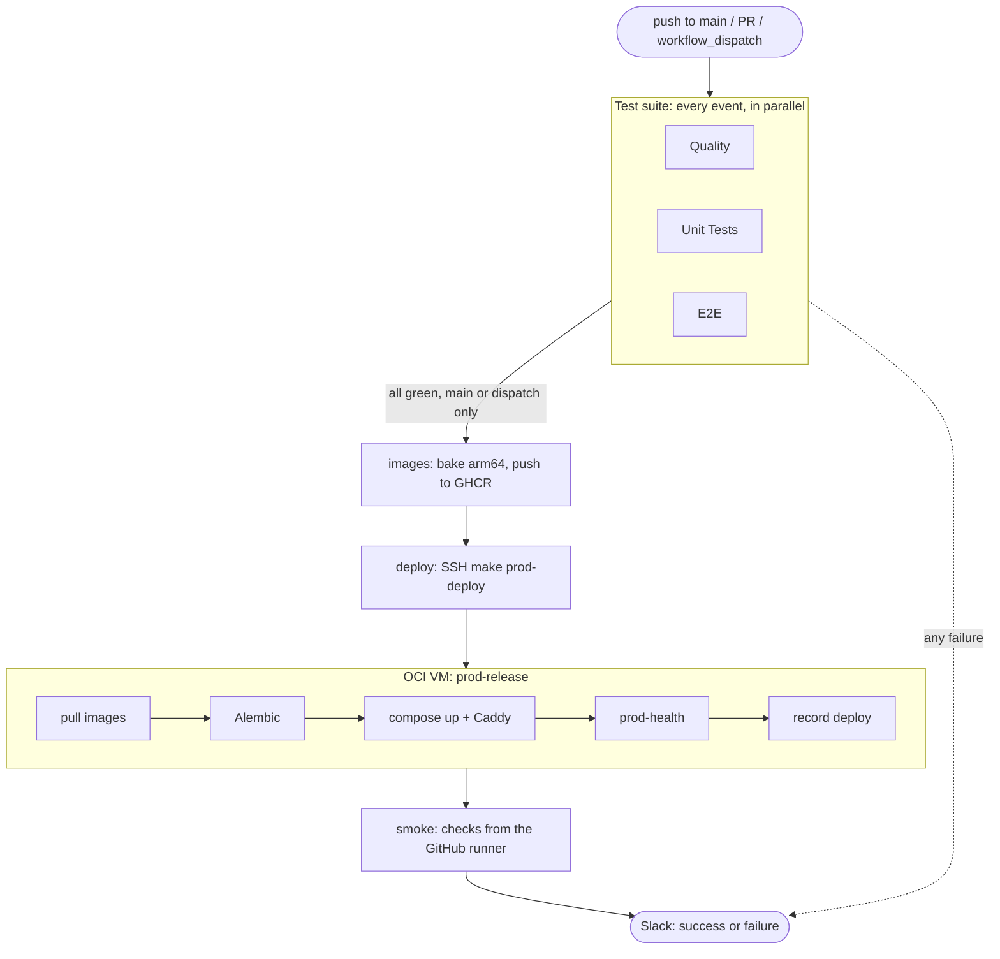

# Deployment

How a merge to `main` reaches https://baseline.jyablonski.dev. Everything lives in [.github/workflows/ci.yml](../.github/workflows/ci.yml) and the `prod-*` targets in the [Makefile](../Makefile). Day-to-day production commands are in [operations.md](operations.md).



## When it runs

| Event               | Tests | Images, deploy, smoke | Slack |
| ------------------- | ----- | --------------------- | ----- |
| Pull request        | yes   | no                    | no    |
| Push to `main`      | yes   | yes                   | yes   |
| `workflow_dispatch` | yes   | yes                   | no    |

Shipping also needs the repo variable `ENABLE_OCI_DEPLOY=true`. Without it, `main` only runs the tests and notifies.

## 1. Test suite

All jobs run in parallel and must pass before anything is built. Each is one `make` target, so CI runs what you run locally ([testing.md](testing.md)).

- **Quality**: pre-commit hooks (`make quality`: ruff, prettier, `ty`, eslint, tsc) and dbt metadata linting (`make dbt-score`).
- **Unit Tests**: Vitest for the frontend, plus one matrix job for the Python services (`lib`, `api`, `scraper`, `mcp`, `cube`, `ml`, `migrate`). They share one setup (uv, pytest, Testcontainers), so the job is written once and runs `make test-<service>` per service. `fail-fast: false` keeps one failure from hiding the rest. Testcontainers integration tests run here too, since they're the only tests that hit Alembic and real SQL.
- **E2E**: Playwright against a mocked API, a full dbt build on a throwaway Postgres, and the `/admin` job runner against a real Postgres.

## 2. Build images to GHCR

The `images` job runs `docker buildx bake --push prod` ([docker-bake.hcl](../docker-bake.hcl)), building every production image: `api`, `frontend`, `migrate`, `mcp` and `cube` for the live site, and `scraper`, `dbt` and `ml` for the daily refresh.

- **arm64 runner.** The VM is ARM (OCI Ampere A1), so images build natively on `ubuntu-24.04-arm`. Emulating ARM is about 10x slower.
- **Tagged by commit.** Images push as `ghcr.io/<owner>/nba-<service>:<sha>` and `:latest`. Deploys use the sha, so you always know what's live.
- **Sha baked in.** The frontend compiles in `NEXT_PUBLIC_GIT_SHA`, which the `/about` page links and the smoke test checks.

Building in CI keeps the work off the 12 GB VM, where a 2-4 GB Next.js build would compete with the live site.

## 3. Deploy on the server

The `deploy` job SSHs to the VM and runs:

```bash
cd /opt/nba && make prod-deploy IMAGE_PREFIX=ghcr.io/<owner>/ IMAGE_TAG=<sha>
```

`prod-deploy` pulls `main` so the Makefile, Compose files and Caddyfile match the images, then runs `make prod-release`:

1. **Pull** every image at `<sha>`. Nothing builds on the VM.
2. **Migrate** the database with Alembic.
3. **Start** `api`, `frontend`, `mcp`, `cube` and `caddy`.
4. **Recreate Caddy** so Caddyfile changes take effect (a plain reload keeps the old file).
5. **Health check** api, frontend, cube and mcp from inside the VM. Any failure stops the deploy.
6. **Record the deploy** in `.env.deploy`, so the daily refresh uses the same images. This comes after the health check so a broken release never becomes the refresh image.
7. **Prune** old image layers.

No step runs `compose down -v`, so the database survives every deploy.

**Rollback**: on the server, run `make prod-release IMAGE_PREFIX=ghcr.io/<owner>/ IMAGE_TAG=<old-sha>`. No rebuild, no migration.

## 4. Smoke test from GitHub

The `smoke` job runs `make prod-smoke EXPECTED_SHA=<sha>` ([scripts/smoke-test.sh](../scripts/smoke-test.sh)) against the public URL.

**Why from outside:** the step 5 health check runs inside the VM, so it can't see DNS, TLS or Caddy routing, which is how users actually arrive. The smoke test goes through all of it and confirms the new commit is the one being served, which catches a stale container that would pass everything else.

It checks the home page, the deployed sha on `/about`, the API, auth routing, and that `/mcp` still requires its token (401). Checks are read-only, need no secrets, and retry so a slow-starting container doesn't fail the run. The script's header lists each one.

Run it any time with `make prod-smoke`.

## 5. Slack notification

`notify` runs last on pushes to `main`, even if an earlier job failed. It waits on every job and sends `pipeline-failure` if any failed, `deployment-success` otherwise. Add new jobs to its `needs` list, or their failures won't turn the message red.

A cancelled job doesn't count as failed, so cancelling a run still sends the success message.
